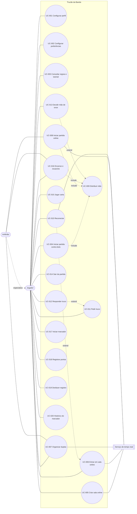

# Trucão da Barela — Casos de uso

> Análise e Projeto de Software · Prof. Dr. João Choma · Situação: **Proposto**
> **20 especificações completas**: objetivos, atores, fluxos, alternativas, exceções, pós-condições e cenários propostos de aceite — **45 critérios de aceite** e **45 cenários de teste**.
> Documentos relacionados: [Plano](plano-arquitetura-implementacao.md) · [Regras de negócio](regras-de-negocio.md) · [Requisitos](requisitos.md)

## Sumário

| Grupo | Casos de uso |
|---|---|
| Perfil e ajuda | [UC-001](#uc-001---configurar-perfil-de-jogador) Configurar perfil de jogador · [UC-002](#uc-002---configurar-preferências) Configurar preferências · [UC-003](#uc-003---consultar-regras-e-tutorial) Consultar regras e tutorial |
| Partida contra bots | [UC-004](#uc-004---iniciar-partida-contra-bots) Iniciar partida contra bots |
| Sala online | [UC-005](#uc-005---criar-sala-online) Criar sala online · [UC-006](#uc-006---entrar-em-sala-online) Entrar em sala online · [UC-007](#uc-007---organizar-duplas-da-sala) Organizar duplas da sala · [UC-008](#uc-008---iniciar-partida-online) Iniciar partida online |
| Mesa de jogo | [UC-009](#uc-009---distribuir-mão) Distribuir mão · [UC-010](#uc-010---jogar-carta) Jogar carta · [UC-011](#uc-011---pedir-truco) Pedir truco · [UC-012](#uc-012---responder-pedido-de-truco) Responder pedido de truco · [UC-013](#uc-013---decidir-mão-de-onze) Decidir mão de onze · [UC-014](#uc-014---sair-da-partida) Sair da partida · [UC-015](#uc-015---reconectar-à-partida-online) Reconectar à partida online · [UC-016](#uc-016---encerrar-partida-e-jogar-revanche) Encerrar partida e jogar revanche |
| Marcador físico | [UC-017](#uc-017---iniciar-marcador-de-pontos) Iniciar marcador de pontos · [UC-018](#uc-018---registrar-pontos-no-marcador) Registrar pontos no marcador · [UC-019](#uc-019---desfazer-registro-no-marcador) Desfazer registro no marcador · [UC-020](#uc-020---consultar-histórico-do-marcador) Consultar histórico do marcador |
| Validação | [Checklist de validação documental](#checklist-de-validação-documental) · [Matriz de rastreabilidade](#matriz-de-rastreabilidade) |

## Contexto, origem e premissas

O Trucão da Barela é um jogo web de truco paulista para duas duplas, com partidas contra bots, partidas online em salas por código e um marcador de pontos para jogos com baralho físico.

**Origem:** proposta do grupo; regras em [regras-de-negocio.md](regras-de-negocio.md); requisitos em [requisitos.md](requisitos.md). Limites e escolhas adicionais são propostas da análise, não atribuídas a entrevistas, aprovação formal ou testes executados.

**Convenções:** os casos de uso descrevem comportamento, não interface. “Sistema” é o Trucão da Barela (navegador e servidor). Bots não são atores: são participantes controlados pelo sistema (RF-021) e executam os mesmos casos de mesa sob as mesmas regras. Quando um passo diz “o participante da vez”, vale para humano ou bot. CA é critério de aceite; CT é cenário de teste proposto. Nenhum teste é declarado executado.

### Atores

| Ator | Tipo | Descrição |
|---|---|---|
| Jogador | Principal | Pessoa que usa o jogo; não possui conta. |
| Anfitrião | Principal | Jogador que criou a sala online; especialização de Jogador. |
| Serviço de tempo real | Secundário | Sistema externo que avisa os navegadores da sala sobre mudanças de estado. |

### Diagrama geral de casos de uso (rascunho)

| Relação | Significado |
|---|---|
| UC-004, UC-008 e UC-016 **incluem** UC-009 | Toda partida (e revanche) começa distribuindo a primeira mão; UC-009 se repete a cada nova mão. |
| UC-013 **estende** UC-009 | Só ocorre quando uma dupla tem 11 pontos após a distribuição. |
| UC-012 **estende** UC-011 | A resposta só existe após um pedido. |
| UC-015 **estende** UC-006 | Entrar com credencial de assento existente de partida em andamento é uma reconexão. |

---

## UC-001 - Configurar perfil de jogador

- **Objetivo:** definir apelido e avatar usados nas partidas.
- **Ator principal:** Jogador.
- **Atores secundários:** nenhum.
- **Gatilho:** o jogador solicita editar o perfil, ou abre o jogo pela primeira vez.
- **Precondições:** nenhuma.
- **Entradas:** apelido; avatar do catálogo.
- **Prioridade / status:** Alta / Proposto.

**Fluxo principal**

1. O jogador solicita configurar o perfil.
2. O sistema apresenta o perfil atual (ou um apelido sugerido e o avatar padrão) e o catálogo de avatares.
3. O jogador informa o apelido, escolhe um avatar e confirma.
4. O sistema valida o apelido (RN-023).
5. O sistema salva o perfil no dispositivo e confirma a alteração.

**Fluxos alternativos**

- **A1 - Apelido inválido** (origem: passo 4): apelido com menos de 2 ou mais de 16 caracteres, ou só espaços. O sistema indica o problema e mantém os dados para correção; retorna ao passo 3.
- **A2 - Cancelar** (origem: passo 3): o jogador desiste; o sistema mantém o perfil anterior e encerra o caso.

**Exceções**

- **E1 - Armazenamento do dispositivo indisponível** (origem: passo 5): o sistema informa que o perfil valerá apenas nesta sessão e o mantém em memória.

**Pós-condições**

- Sucesso: perfil salvo e usado nas próximas partidas e salas.
- Falha/cancelamento: perfil anterior preservado.

**Rastreabilidade e verificação**

- RF-001: definir apelido e avatar sem conta. Regras: RN-023.
- CA-001.1: apelido de 2 a 16 caracteres e avatar do catálogo são salvos e reaparecem ao reabrir o jogo.
- CT-001.1: informar “Barela” e o avatar “Mineradora”; fechar e reabrir o jogo. Esperado: perfil “Barela” com o avatar escolhido.
- CA-001.2: apelido inválido não é salvo e o perfil anterior é preservado.
- CT-001.2: com perfil “Barela”, tentar salvar “B”. Esperado: orientação de correção; perfil continua “Barela”.

## UC-002 - Configurar preferências

- **Objetivo:** ajustar som, velocidade e alto contraste.
- **Ator principal:** Jogador.
- **Atores secundários:** nenhum.
- **Gatilho:** o jogador solicita as preferências.
- **Precondições:** nenhuma.
- **Entradas:** som (ligado/desligado, volume); velocidade (lenta, normal, rápida); alto contraste (sim/não).
- **Prioridade / status:** Baixa / Proposto.

**Fluxo principal**

1. O jogador solicita as preferências.
2. O sistema apresenta os valores atuais.
3. O jogador altera um ou mais valores.
4. O sistema aplica cada alteração imediatamente e a salva no dispositivo.

**Fluxos alternativos**

- **A1 - Restaurar padrão** (origem: passo 3): o jogador solicita restaurar; o sistema volta aos valores padrão (som ligado, volume 70%, velocidade normal, sem alto contraste) e os salva.
- **A2 - Durante a partida** (origem: passo 1): as preferências abertas na mesa não pausam a partida online; contra bots, a partida aguarda o fechamento.

**Exceções**

- **E1 - Armazenamento indisponível** (origem: passo 4): as preferências valem só nesta sessão e o jogador é informado.

**Pós-condições**

- Sucesso: preferências aplicadas e salvas.
- Falha/cancelamento: valores anteriores preservados.

**Rastreabilidade e verificação**

- RF-002. Regras: —.
- CA-002.1: preferências alteradas são aplicadas imediatamente e mantidas ao reabrir.
- CT-002.1: ativar alto contraste e velocidade rápida; reabrir o jogo. Esperado: ambos ativos.
- CA-002.2: restaurar padrão retorna todos os valores originais.
- CT-002.2: após alterar tudo, restaurar padrão. Esperado: valores padrão listados em A1.

## UC-003 - Consultar regras e tutorial

- **Objetivo:** aprender as regras adotadas e praticar uma mão guiada.
- **Ator principal:** Jogador.
- **Atores secundários:** nenhum.
- **Gatilho:** o jogador solicita as regras.
- **Precondições:** nenhuma.
- **Entradas:** seção escolhida; ações do tutorial.
- **Prioridade / status:** Média / Proposto.

**Fluxo principal**

1. O jogador solicita as regras.
2. O sistema apresenta as seções: cartas e manilha, rodadas e mão, truco, mão de onze e mão de ferro, variações adotadas.
3. O jogador escolhe uma seção; o sistema apresenta o conteúdo com exemplos ilustrados.
4. O jogador solicita o tutorial; o sistema conduz uma mão com cartas pré-definidas, indicando a ação esperada em cada passo.
5. O jogador conclui o tutorial; o sistema registra a conclusão no dispositivo.

**Fluxos alternativos**

- **A1 - Ação diferente da indicada** (origem: passo 4): o sistema explica por que outra ação é recomendada e permite tentar de novo.
- **A2 - Abandonar o tutorial** (origem: passo 4): o sistema encerra o tutorial sem registrar conclusão.

**Exceções**

- Nenhuma (conteúdo disponível sem conexão, RNF-006).

**Pós-condições**

- Sucesso: regras apresentadas; tutorial concluído.
- Falha/cancelamento: nenhuma partida é afetada.

**Rastreabilidade e verificação**

- RF-003. Regras: RN-001 a RN-017 (conteúdo).
- CA-003.1: a tela apresenta hierarquia das cartas, manilha, truco, mão de onze e mão de ferro conforme as RNs.
- CT-003.1: abrir “Cartas e manilha”. Esperado: ordem 4…3 da RN-002, exemplo “vira 3 → manilha 4” e ordem dos naipes da RN-004.
- CA-003.2: o tutorial pode ser concluído ou abandonado sem afetar partidas.
- CT-003.2: com partida contra bots salva, abandonar o tutorial no passo 2. Esperado: partida salva inalterada; tutorial não marcado como concluído.

## UC-004 - Iniciar partida contra bots

- **Objetivo:** jogar uma partida com um bot parceiro contra dois bots.
- **Ator principal:** Jogador.
- **Atores secundários:** nenhum.
- **Gatilho:** o jogador solicita jogar contra bots.
- **Precondições:** jogo carregado no navegador.
- **Entradas:** dificuldade do parceiro; dificuldade dos adversários.
- **Prioridade / status:** Alta / Proposto.

**Fluxo principal**

1. O jogador solicita uma partida contra bots.
2. O sistema apresenta os níveis fácil, médio e difícil para parceiro e adversários, com médio pré-selecionado.
3. O jogador escolhe os níveis e confirma.
4. O sistema forma a dupla A com o jogador (assento 0) e o bot parceiro (assento 2), e a dupla B com dois bots (assentos 1 e 3), com nomes e avatares do catálogo (RN-005, RN-019).
5. O sistema cria a partida com placar 0×0 e sorteia o carteador.
6. O sistema executa UC-009 e apresenta a mesa (RF-022).

**Fluxos alternativos**

- **A1 - Partida anterior não concluída** (origem: passo 1): o sistema oferece continuar a partida salva ou começar nova. Ao continuar, apresenta a mesa no ponto salvo e o caso termina; ao começar nova, descarta a salva e segue ao passo 2.
- **A2 - Cancelar** (origem: passo 3): o sistema retorna ao início sem criar partida.

**Exceções**

- **E1 - Falha ao carregar a arte** (origem: passo 6): o sistema apresenta cartas em modo texto (valor e naipe) e permite jogar normalmente.

**Pós-condições**

- Sucesso: partida em andamento, salva no dispositivo a cada mão.
- Falha/cancelamento: nenhuma partida criada.

**Rastreabilidade e verificação**

- RF-004, RF-021. Regras: RN-005, RN-019.
- CA-004.1: a partida inicia com o jogador e um bot na mesma dupla contra dois bots, nas dificuldades escolhidas.
- CT-004.1: escolher parceiro fácil e adversários difíceis. Esperado: assento 2 bot fácil; assentos 1 e 3 bots difíceis; placar 0×0; 3 cartas na mão do jogador.
- CA-004.2: a partida contra bots funciona sem conexão depois de o jogo ter sido carregado.
- CT-004.2: carregar o jogo, ativar modo avião e iniciar partida. Esperado: partida jogável até o fim.

## UC-005 - Criar sala online

- **Objetivo:** criar uma sala para jogar com outras pessoas.
- **Ator principal:** Jogador (torna-se Anfitrião).
- **Atores secundários:** Serviço de tempo real.
- **Gatilho:** o jogador solicita criar sala.
- **Precondições:** conexão com a internet.
- **Entradas:** perfil do jogador.
- **Prioridade / status:** Média / Proposto.

**Fluxo principal**

1. O jogador solicita criar uma sala online.
2. O sistema gera um código único de 6 caracteres sem caracteres ambíguos (RN-020).
3. O sistema registra a sala como aguardando, com expiração em 30 minutos, e coloca o jogador no assento 0 como anfitrião.
4. O sistema entrega ao navegador a credencial do assento e assina o canal da sala no Serviço de tempo real.
5. O sistema apresenta o lobby com o código, o link de convite e os 4 assentos.

**Fluxos alternativos**

- **A1 - Perfil não configurado** (origem: passo 1): o sistema usa o apelido sugerido e o avatar padrão, permitindo editá-los no lobby (UC-001).
- **A2 - Código já em uso** (origem: passo 2): o sistema gera outro código e repete a verificação.

**Exceções**

- **E1 - Serviço indisponível** (origem: passos 3 ou 4): o sistema informa que não foi possível criar a sala, não exibe código e oferece jogar contra bots.

**Pós-condições**

- Sucesso: sala aguardando com o criador como anfitrião.
- Falha/cancelamento: nenhuma sala é registrada.

**Rastreabilidade e verificação**

- RF-005. Regras: RN-020, RN-023.
- CA-005.1: a sala criada tem código único de 6 caracteres e o criador ocupa um assento como anfitrião.
- CT-005.1: criar sala com perfil “Barela”. Esperado: código de 6 caracteres sem O, 0, I ou 1; “Barela (anfitrião)” no assento 0.
- CA-005.2: falha do serviço não gera sala parcial nem exibe código.
- CT-005.2: simular indisponibilidade do banco ao criar. Esperado: mensagem de falha, nenhum código exibido e nenhuma sala no banco.

## UC-006 - Entrar em sala online

- **Objetivo:** ocupar um assento em sala de outro jogador.
- **Ator principal:** Jogador.
- **Atores secundários:** Serviço de tempo real.
- **Gatilho:** o jogador informa um código ou abre um link de convite.
- **Precondições:** conexão com a internet.
- **Entradas:** código da sala; perfil.
- **Prioridade / status:** Média / Proposto.

**Fluxo principal**

1. O jogador informa o código da sala (ou abre o link).
2. O sistema localiza a sala e verifica que está aguardando, não expirou e tem assento livre (RN-020).
3. O sistema ajusta o apelido se já houver outro igual na sala (RN-023).
4. O sistema coloca o jogador no primeiro assento livre e entrega a credencial do assento.
5. O sistema avisa a sala pelo Serviço de tempo real.
6. O sistema apresenta o lobby com os participantes e duplas atuais.

**Fluxos alternativos**

- **A1 - Código inexistente** (origem: passo 2): o sistema informa que a sala não foi encontrada e permite corrigir o código; retorna ao passo 1.
- **A2 - Sala cheia, em jogo, encerrada ou expirada** (origem: passo 2): o sistema informa o motivo e não ocupa assento. Se o navegador tiver credencial de assento dessa sala em jogo, segue para UC-015.
- **A3 - Assento ocupado por bot** (origem: passo 4): não havendo assento vazio mas havendo bot, o sistema substitui o bot pelo jogador.

**Exceções**

- **E1 - Serviço indisponível** (origem: passos 2 a 5): o sistema informa a falha e não ocupa assento.
- **E2 - Dois jogadores pelo último assento** (origem: passo 4): apenas o primeiro a ser gravado o ocupa; o outro recebe A2 (sala cheia).

**Pós-condições**

- Sucesso: jogador em um assento da sala, com credencial guardada no dispositivo.
- Falha/cancelamento: nenhum assento ocupado pelo jogador.

**Rastreabilidade e verificação**

- RF-006. Regras: RN-020, RN-022, RN-023.
- CA-006.1: código válido de sala aguardando com vaga coloca o jogador em assento livre.
- CT-006.1: com sala “K7MP2Q” tendo só o anfitrião, entrar com “Carol”. Esperado: “Carol” no assento 1; anfitrião vê a entrada em até 1 s.
- CA-006.2: código inexistente, sala cheia, em jogo ou expirada é recusado sem ocupar assento.
- CT-006.2: entrar em sala com 4 humanos. Esperado: “sala cheia” e nenhum assento alterado.
- CA-006.3: apelido repetido na sala recebe sufixo numérico.
- CT-006.3: sala com “Ana”; entrar com “Ana”. Esperado: participante exibido como “Ana 2”.

## UC-007 - Organizar duplas da sala

- **Objetivo:** definir quem joga com quem antes do início.
- **Ator principal:** Anfitrião; Jogador (apenas o próprio assento).
- **Atores secundários:** Serviço de tempo real.
- **Gatilho:** um participante solicita mudar um assento.
- **Precondições:** sala aguardando; participante na sala.
- **Entradas:** assento de origem e destino; ou assento e nível do bot.
- **Prioridade / status:** Média / Proposto.

**Fluxo principal**

1. O anfitrião solicita adicionar um bot a um assento livre.
2. O sistema apresenta os níveis fácil, médio e difícil.
3. O anfitrião escolhe o nível e confirma.
4. O sistema coloca o bot no assento, com nome e avatar do catálogo, e atualiza as duplas (RN-005, RN-019).
5. O sistema avisa a sala pelo Serviço de tempo real e todos veem a nova formação.

**Fluxos alternativos**

- **A1 - Remover bot** (origem: passo 1): o anfitrião remove um bot; o assento fica livre; segue ao passo 5.
- **A2 - Trocar assentos** (origem: passo 1): o anfitrião troca dois participantes de assento; segue ao passo 5.
- **A3 - Jogador escolhe o próprio assento** (origem: passo 1): um jogador move-se para um assento livre; segue ao passo 5.
- **A4 - Sortear duplas** (origem: passo 1): o anfitrião solicita sorteio; o sistema distribui aleatoriamente os 4 participantes; segue ao passo 5.

**Exceções**

- **E1 - Sem permissão** (origem: passo 1): um participante que não é anfitrião tenta alterar o assento de outro; o sistema recusa sem alterar a sala.
- **E2 - Alteração concorrente** (origem: passo 4): o assento mudou antes da gravação; o sistema recusa e apresenta a formação atual.

**Pós-condições**

- Sucesso: assentos e duplas atualizados para todos.
- Falha/cancelamento: formação anterior preservada.

**Rastreabilidade e verificação**

- RF-007, RF-021. Regras: RN-005, RN-019, RN-020.
- CA-007.1: o anfitrião adiciona e remove bots em assentos livres, escolhendo a dificuldade.
- CT-007.1: adicionar bot difícil no assento 3 e depois removê-lo. Esperado: bot difícil no assento 3; após remoção, assento livre.
- CA-007.2: trocas de assento atualizam as duplas para todos os participantes.
- CT-007.2: trocar “Carol” (1) com “Ana” (2). Esperado: nos dois navegadores, “Barela e Carol” formam a dupla A.
- CA-007.3: participante que não é anfitrião não altera o assento de outros.
- CT-007.3: “Carol” tenta mover “Ana”. Esperado: recusa e formação inalterada.

## UC-008 - Iniciar partida online

- **Objetivo:** começar a partida da sala.
- **Ator principal:** Anfitrião.
- **Atores secundários:** Serviço de tempo real.
- **Gatilho:** o anfitrião solicita iniciar.
- **Precondições:** sala aguardando com 4 assentos ocupados.
- **Entradas:** comando de início.
- **Prioridade / status:** Média / Proposto.

**Fluxo principal**

1. O anfitrião solicita iniciar a partida.
2. O sistema verifica que o solicitante é o anfitrião e que os 4 assentos estão ocupados (RN-020).
3. O sistema altera a sala para em jogo, cria a partida 0×0 e sorteia o carteador.
4. O sistema executa UC-009.
5. O sistema avisa a sala e cada participante recebe sua visão da mesa (RF-022).

**Fluxos alternativos**

- **A1 - Assentos vazios** (origem: passo 2): o sistema informa quantos faltam e oferece completar com bots (UC-007); o caso termina sem iniciar.

**Exceções**

- **E1 - Solicitante não é anfitrião** (origem: passo 2): o sistema recusa.
- **E2 - Falha ao gravar** (origem: passo 3): o sistema mantém a sala aguardando e informa a falha.

**Pós-condições**

- Sucesso: sala em jogo, partida com primeira mão distribuída.
- Falha/cancelamento: sala permanece aguardando.

**Rastreabilidade e verificação**

- RF-008. Regras: RN-005, RN-020.
- CA-008.1: somente o anfitrião, com 4 assentos ocupados, inicia a partida.
- CT-008.1: com 3 assentos ocupados, o anfitrião solicita iniciar. Esperado: “falta 1 participante” e sala aguardando.
- CA-008.2: ao iniciar, todos os participantes recebem a primeira mão.
- CT-008.2: com 2 humanos e 2 bots, iniciar. Esperado: cada navegador mostra 3 cartas próprias, a vira e placar 0×0.

## UC-009 - Distribuir mão

- **Objetivo:** preparar uma nova mão.
- **Ator principal:** nenhum (caso incluído por UC-004, UC-008 e UC-016 e repetido pelo sistema ao fim de cada mão).
- **Atores secundários:** Serviço de tempo real (online).
- **Gatilho:** início da partida ou fim de mão sem vencedor da partida.
- **Precondições:** partida em andamento; nenhuma dupla com 12.
- **Entradas:** placar; carteador anterior.
- **Prioridade / status:** Alta / Proposto.

**Fluxo principal**

1. O sistema define o carteador: sorteado na primeira mão, ou o seguinte no sentido anti-horário (RN-006).
2. O sistema monta o baralho de 40 cartas e o embaralha (RN-001).
3. O sistema entrega 3 cartas a cada participante.
4. O sistema vira a carta seguinte do monte e define a manilha (RN-003).
5. O sistema define a mão valendo 1 ponto e a vez do participante seguinte ao carteador.
6. O sistema apresenta a cada participante sua visão (RN-018, RF-022) e aguarda a jogada (UC-010).

**Fluxos alternativos**

- **A1 - Mão de onze** (origem: passo 5): apenas uma dupla tem 11; o sistema executa UC-013 antes da primeira jogada.
- **A2 - Mão de ferro** (origem: passo 5): as duas duplas têm 11; o sistema define a mão valendo 1, oculta as cartas inclusive do próprio dono e desabilita truco e carta encoberta (RN-016); segue ao passo 6.

**Exceções**

- **E1 - Falha ao gravar a mão (online)** (origem: passo 6): o sistema repete a gravação com a mesma mão; nenhuma carta é apresentada antes da gravação confirmada.

**Pós-condições**

- Sucesso: mão pronta com cartas, vira, manilha, valor e vez definidos.
- Falha/cancelamento: mão anterior permanece como a última registrada.

**Rastreabilidade e verificação**

- RF-009, RF-022. Regras: RN-001, RN-003, RN-006, RN-015, RN-016, RN-018.
- CA-009.1: cada participante recebe 3 cartas distintas e a vira define a manilha.
- CT-009.1: semente fixa com vira K de Copas. Esperado: 12 cartas distintas distribuídas, nenhuma igual à vira, manilha A.
- CA-009.2: o carteador gira a cada mão.
- CT-009.2: carteador sorteado no assento 2; encerrar a mão. Esperado: próximo carteador assento 3 e primeira jogada do assento 0.
- CA-009.3: placar com 11 aciona mão de onze ou mão de ferro.
- CT-009.3: placar 11×11. Esperado: cartas ocultas para todos, valor 1, botão de truco indisponível.

## UC-010 - Jogar carta

- **Objetivo:** jogar uma carta na rodada.
- **Ator principal:** Jogador.
- **Atores secundários:** Serviço de tempo real (online).
- **Gatilho:** é a vez do jogador.
- **Precondições:** partida em andamento; vez do jogador; nenhuma decisão pendente.
- **Entradas:** carta; indicação de encoberta.
- **Prioridade / status:** Alta / Proposto.

**Fluxo principal**

1. O sistema indica que é a vez do jogador e as ações válidas (jogar, encobrir quando permitido, pedir truco).
2. O jogador escolhe uma carta da sua mão, aberta, e confirma.
3. O sistema valida a jogada (RN-008) e registra a carta na rodada.
4. O sistema apresenta a carta a todos e passa a vez ao próximo participante no sentido anti-horário (RN-007).
5. Quando os 4 jogaram, o sistema determina o resultado da rodada (RN-002 a RN-004, RN-009).
6. O sistema verifica se a mão está decidida (RN-010); se não, define quem inicia a próxima rodada (RN-007) e retorna ao passo 1 para o participante da vez.
7. Com a mão decidida, o sistema soma o valor da mão à dupla vencedora (RN-017).
8. Se nenhuma dupla alcançou 12, o sistema executa UC-009; caso contrário, executa UC-016.

**Fluxos alternativos**

- **A1 - Carta encoberta** (origem: passo 2): na 2ª ou 3ª rodada, o jogador escolhe jogar encoberta; o sistema registra a carta sem valor e sem revelá-la aos demais (RN-011); segue ao passo 4.
- **A2 - Pedir truco antes de jogar** (origem: passo 1): o jogador segue UC-011; após a resposta, se a mão continuar, retorna ao passo 1.
- **A3 - Vez de um bot** (origem: passo 4): o sistema decide pelo bot (RF-021) e segue ao passo 3 para essa jogada.
- **A4 - Prazo expirado (online)** (origem: passo 2): o sistema decide aquela jogada pelo bot médio e a registra como automática (RN-021); segue ao passo 3.
- **A5 - Três rodadas empatadas** (origem: passo 6): ninguém pontua; o sistema executa UC-009.

**Exceções**

- **E1 - Jogada inválida** (origem: passo 3): fora da vez, carta já jogada, carta alheia, encoberta na 1ª rodada ou na mão de ferro. O sistema recusa sem alterar a partida.
- **E2 - Ação concorrente (online)** (origem: passo 3): o estado mudou antes da gravação; o sistema recusa, apresenta o estado atual e o jogador decide de novo se ainda for a sua vez.

**Pós-condições**

- Sucesso: carta registrada; rodada, mão, placar e vez atualizados.
- Falha/cancelamento: partida inalterada.

**Rastreabilidade e verificação**

- RF-010, RF-021, RF-022. Regras: RN-002 a RN-004, RN-007 a RN-011, RN-016, RN-017, RN-021.
- CA-010.1: somente jogada válida do participante da vez é aceita.
- CT-010.1: na vez do assento 0, o assento 1 envia uma jogada. Esperado: recusa e estado inalterado.
- CA-010.2: os vencedores da rodada e da mão são calculados conforme RN-009 e RN-010.
- CT-010.2: manilha Q; rodada com 3♦ (A), 3♠ (B), 2♥ (A), K♣ (B). Esperado: rodada empatada; a dupla que vencer a 2ª rodada vence a mão.
- CA-010.3: carta encoberta só é aceita a partir da 2ª rodada e não tem valor.
- CT-010.3: encobrir na 1ª rodada (recusado); na 2ª, encobrir um 3 contra 4 aberto. Esperado: o 4 vence a rodada e o 3 não é revelado aos demais.

## UC-011 - Pedir truco

- **Objetivo:** elevar o valor da mão.
- **Ator principal:** Jogador.
- **Atores secundários:** Serviço de tempo real (online).
- **Gatilho:** na sua vez, o jogador solicita truco (ou seis, nove, doze).
- **Precondições:** vez do jogador, antes de jogar a carta; mão normal; valor menor que 12.
- **Entradas:** comando de pedido.
- **Prioridade / status:** Alta / Proposto.

**Fluxo principal**

1. O jogador solicita o pedido.
2. O sistema verifica que é a vez dele, antes da jogada, que a dupla dele pode pedir e que a mão permite truco (RN-008, RN-013).
3. O sistema registra o pedido com o valor seguinte da escada (RN-012) e identifica o respondente (RN-014).
4. O sistema anuncia o pedido a todos (RF-022) e bloqueia jogadas enquanto houver pedido pendente.
5. O sistema aguarda a resposta do respondente (UC-012).

**Fluxos alternativos**

- **A1 - Respondente bot** (origem: passo 5): o sistema decide pelo bot (RF-021).

**Exceções**

- **E1 - Pedido não permitido** (origem: passo 2): fora da vez, depois de jogar, mesma dupla do último pedido aceito, mão de onze, mão de ferro ou valor 12. O sistema recusa sem alterar a mão.

**Pós-condições**

- Sucesso: pedido pendente aguardando resposta.
- Falha/cancelamento: mão inalterada.

**Rastreabilidade e verificação**

- RF-011, RF-021, RF-022. Regras: RN-008, RN-012, RN-013.
- CA-011.1: o pedido só é aceito na vez, antes da jogada, pela dupla com direito a pedir.
- CT-011.1: dupla A pede truco e B aceita; na vez seguinte de A, A pede seis. Esperado: recusa; na vez de B, B pode pedir seis.
- CA-011.2: o pedido é bloqueado na mão de onze, na mão de ferro e com valor 12.
- CT-011.2: na mão de ferro, solicitar truco. Esperado: recusa e valor continua 1.

## UC-012 - Responder pedido de truco

- **Objetivo:** aceitar, correr ou aumentar um pedido.
- **Ator principal:** Jogador.
- **Atores secundários:** Serviço de tempo real (online).
- **Gatilho:** há pedido pendente dirigido ao jogador.
- **Precondições:** pedido pendente; o jogador é o respondente (RN-014).
- **Entradas:** aceitar, correr ou aumentar.
- **Prioridade / status:** Alta / Proposto.

**Fluxo principal**

1. O sistema apresenta o pedido, o valor em disputa e as opções válidas ao respondente.
2. O jogador escolhe **aceitar**.
3. O sistema valida a resposta e eleva o valor da mão ao valor pedido (RN-012).
4. O sistema anuncia a resposta a todos.
5. O sistema devolve a vez a quem pediu, que segue UC-010.

**Fluxos alternativos**

- **A1 - Correr** (origem: passo 2): o sistema encerra a mão e soma à dupla solicitante o valor vigente antes do pedido (RN-014, RN-017); segue UC-010 passo 8.
- **A2 - Aumentar** (origem: passo 2): com valor pedido menor que 12, o sistema aceita o pedido atual, registra o próximo valor como novo pedido dirigido à outra dupla e retorna ao passo 1 para o novo respondente.
- **A3 - Respondente bot** (origem: passo 2): o sistema decide pelo bot (RF-021).
- **A4 - Prazo expirado (online)** (origem: passo 2): o bot médio decide aquela resposta (RN-021).

**Exceções**

- **E1 - Resposta inválida** (origem: passo 3): de quem não é respondente, ou aumento acima de 12. O sistema recusa sem alterar a mão.

**Pós-condições**

- Sucesso: valor elevado e jogo continua; ou mão encerrada; ou novo pedido pendente.
- Falha/cancelamento: pedido continua pendente.

**Rastreabilidade e verificação**

- RF-012, RF-021, RF-022. Regras: RN-012, RN-014, RN-017, RN-021.
- CA-012.1: aceitar eleva o valor da mão ao valor pedido.
- CT-012.1: pedido de truco aceito. Esperado: “valendo 3” e vez de quem pediu.
- CA-012.2: correr encerra a mão e dá ao solicitante o valor anterior ao pedido.
- CT-012.2: placar 4×4, mão valendo 3, dupla A pede seis e B corre. Esperado: 7×4 e nova mão distribuída.
- CA-012.3: aumentar gera novo pedido dirigido à outra dupla.
- CT-012.3: A pede truco, B aumenta para seis. Esperado: valor 3 aceito e pedido de seis pendente para o primeiro respondente da dupla A.

## UC-013 - Decidir mão de onze

- **Objetivo:** decidir se a dupla com 11 joga a mão.
- **Ator principal:** Jogador.
- **Atores secundários:** Serviço de tempo real (online).
- **Gatilho:** UC-009 identificou mão de onze.
- **Precondições:** apenas a dupla do jogador tem 11; o jogador é o decisor (RN-015).
- **Entradas:** jogar ou correr.
- **Prioridade / status:** Alta / Proposto.

**Fluxo principal**

1. O sistema apresenta à dupla com 11 as próprias cartas e as do parceiro, e aos adversários o aviso “mão de onze”.
2. O decisor escolhe **jogar**.
3. O sistema define a mão valendo 3 e desabilita o truco nela (RN-015).
4. O sistema anuncia a decisão a todos.
5. O sistema libera a primeira jogada (UC-010).

**Fluxos alternativos**

- **A1 - Correr** (origem: passo 2): o sistema soma 1 ponto à dupla adversária, encerra a mão e executa UC-009 (ou UC-016, se a adversária alcançar 12).
- **A2 - Decisor bot** (origem: passo 2): o sistema decide pelo bot (RF-021).
- **A3 - Prazo expirado (online)** (origem: passo 2): o bot médio decide pelo jogador (RN-021).

**Exceções**

- **E1 - Decisão de quem não é decisor** (origem: passo 2): o sistema recusa.

**Pós-condições**

- Sucesso: mão de onze valendo 3, ou adversária +1.
- Falha/cancelamento: decisão continua pendente.

**Rastreabilidade e verificação**

- RF-013, RF-021, RF-022. Regras: RN-015, RN-017, RN-018, RN-021.
- CA-013.1: a dupla com 11 vê as 6 cartas antes de decidir.
- CT-013.1: placar 11×5, jogador com bot parceiro. Esperado: o jogador vê suas 3 cartas e as 3 do bot; adversários continuam sem ver nenhuma.
- CA-013.2: jogar faz a mão valer 3 sem truco; correr dá 1 ponto à adversária.
- CT-013.2: placar 11×5, correr. Esperado: 11×6 e nova mão de onze distribuída.

## UC-014 - Sair da partida

- **Objetivo:** deixar a mesa ou a sala.
- **Ator principal:** Jogador.
- **Atores secundários:** Serviço de tempo real (online).
- **Gatilho:** o jogador solicita sair.
- **Precondições:** partida em andamento ou sala aguardando.
- **Entradas:** confirmação de saída.
- **Prioridade / status:** Média / Proposto.

**Fluxo principal**

1. O jogador solicita sair da partida.
2. O sistema pede confirmação, informando o efeito (encerrar a partida contra bots, ou bot assumir o assento online).
3. O jogador confirma.
4. Na partida contra bots, o sistema encerra a partida sem registrar resultado e descarta o salvamento.
5. O sistema retorna o jogador ao início.

**Fluxos alternativos**

- **A1 - Partida online** (origem: passo 4): o sistema coloca um bot médio no assento (RN-022), avisa a sala e a partida continua para os demais.
- **A2 - Anfitrião sai da sala aguardando** (origem: passo 4): o sistema passa a função de anfitrião ao próximo humano; sem humanos, encerra a sala.
- **A3 - Desistir** (origem: passo 3): o jogador não confirma; a partida continua.
- **A4 - Último humano sai da partida online** (origem: passo 4): o sistema encerra a partida e a sala.

**Exceções**

- **E1 - Falha ao avisar o servidor (online)** (origem: passo 4): o sistema retorna ao início; o assento será assumido por bot após 60 s sem sinal (RN-022).

**Pós-condições**

- Sucesso: jogador fora da mesa; partida encerrada (bots) ou continuando com bot (online).
- Falha/cancelamento: o jogador permanece na partida.

**Rastreabilidade e verificação**

- RF-014, RF-021. Regras: RN-022.
- CA-014.1: contra bots, sair pede confirmação e encerra sem registrar resultado.
- CT-014.1: sair no meio de partida contra bots. Esperado: confirmação; após confirmar, nenhuma partida para continuar.
- CA-014.2: online, um bot assume o assento e a partida continua para os demais.
- CT-014.2: “Carol” sai durante a partida. Esperado: bot no assento 1 em até 1 s; demais continuam jogando.

## UC-015 - Reconectar à partida online

- **Objetivo:** recuperar o próprio assento.
- **Ator principal:** Jogador.
- **Atores secundários:** Serviço de tempo real.
- **Gatilho:** o jogador reabre a sala, ou a conexão volta.
- **Precondições:** credencial de assento guardada no dispositivo.
- **Entradas:** código da sala; credencial de assento.
- **Prioridade / status:** Média / Proposto.

**Fluxo principal**

1. O sistema identifica a credencial da sala guardada no dispositivo e a envia.
2. O sistema verifica a credencial e que a partida da sala está em andamento.
3. O sistema devolve o assento ao jogador, retirando o bot temporário a partir da próxima decisão (RN-022).
4. O sistema apresenta a visão atual da mesa ao jogador (RF-022).
5. O sistema avisa a sala da reconexão.

**Fluxos alternativos**

- **A1 - Conexão volta em menos de 60 s** (origem: passo 1): o assento ainda é do jogador; o sistema apenas atualiza a visão (passo 4).
- **A2 - Decisão em curso pelo bot** (origem: passo 3): a decisão em andamento é concluída pelo bot; o jogador assume a seguinte.

**Exceções**

- **E1 - Credencial inválida ou partida encerrada** (origem: passo 2): o sistema informa que não há assento a recuperar e apresenta o resultado final, se houver.

**Pós-condições**

- Sucesso: jogador controla o mesmo assento.
- Falha/cancelamento: nenhum assento concedido.

**Rastreabilidade e verificação**

- RF-015, RF-021. Regras: RN-020, RN-022.
- CA-015.1: credencial válida devolve o mesmo assento e as cartas atuais.
- CT-015.1: fechar a aba do assento 2 por 90 s e reabrir. Esperado: assento 2 de volta com as cartas atuais da mão em andamento.
- CA-015.2: credencial inválida ou partida encerrada não concede assento.
- CT-015.2: alterar a credencial guardada e reabrir. Esperado: recusa e nenhum assento alterado.

## UC-016 - Encerrar partida e jogar revanche

- **Objetivo:** ver o resultado e, se quiser, jogar de novo.
- **Ator principal:** Jogador; Anfitrião (online).
- **Atores secundários:** Serviço de tempo real (online).
- **Gatilho:** uma dupla alcançou 12 pontos (UC-010, UC-012 ou UC-013).
- **Precondições:** partida em andamento com vencedora definida.
- **Entradas:** revanche ou voltar ao início.
- **Prioridade / status:** Baixa / Proposto.

**Fluxo principal**

1. O sistema encerra a partida e apresenta a dupla vencedora e o placar final (RN-017).
2. O jogador (contra bots) ou o anfitrião (online) solicita revanche.
3. O sistema cria nova partida com as mesmas duplas, placar 0×0 e novo sorteio de carteador (RN-026); online, assentos de quem saiu ficam com bots.
4. O sistema executa UC-009.
5. O sistema apresenta a mesa a todos.

**Fluxos alternativos**

- **A1 - Voltar ao início** (origem: passo 2): o jogador sai da tela final; online, segue UC-014.
- **A2 - Não anfitrião (online)** (origem: passo 2): o participante só vê “aguardando o anfitrião”.

**Exceções**

- **E1 - Nenhum humano restante (online)** (origem: passo 2): a revanche não é oferecida e a sala é encerrada.

**Pós-condições**

- Sucesso: resultado apresentado; nova partida em andamento, se houver revanche.
- Falha/cancelamento: partida encerrada com resultado preservado.

**Rastreabilidade e verificação**

- RF-016. Regras: RN-006, RN-017, RN-026.
- CA-016.1: a tela final apresenta a dupla vencedora e o placar.
- CT-016.1: dupla A vence com 13×8. Esperado: “Dupla A venceu — 13 × 8”.
- CA-016.2: a revanche mantém as duplas e zera o placar; online, só o anfitrião a inicia.
- CT-016.2: online, “Carol” tenta iniciar revanche (recusado); anfitrião inicia. Esperado: mesmas duplas e 0×0.

## UC-017 - Iniciar marcador de pontos

- **Objetivo:** começar a contagem de uma partida com baralho físico.
- **Ator principal:** Jogador.
- **Atores secundários:** nenhum.
- **Gatilho:** o jogador solicita o marcador.
- **Precondições:** nenhuma.
- **Entradas:** nomes das duplas (opcionais).
- **Prioridade / status:** Média / Proposto.

**Fluxo principal**

1. O jogador solicita o marcador.
2. O sistema sugere os nomes “Nós” e “Eles”.
3. O jogador mantém ou altera os nomes e confirma.
4. O sistema cria a partida do marcador 0×0, salva no dispositivo e apresenta o placar.

**Fluxos alternativos**

- **A1 - Marcador em andamento** (origem: passo 1): o sistema retoma o placar salvo; o caso termina.
- **A2 - Nova partida com marcador em andamento** (origem: passo 1): o sistema pede confirmação para descartar o placar atual (sem gravar no histórico) e segue ao passo 2.

**Exceções**

- **E1 - Armazenamento indisponível** (origem: passo 4): o marcador funciona só nesta sessão e o jogador é informado.

**Pós-condições**

- Sucesso: marcador 0×0 em andamento.
- Falha/cancelamento: marcador anterior preservado.

**Rastreabilidade e verificação**

- RF-017. Regras: RN-024, RN-025.
- CA-017.1: o marcador inicia 0×0 com os nomes padrão ou informados.
- CT-017.1: iniciar com “Barela e Carol” × “Ana e Matheus”. Esperado: placar 0×0 com esses nomes.
- CA-017.2: marcador em andamento é retomado ao reabrir o jogo.
- CT-017.2: com 7×5, fechar e reabrir. Esperado: 7×5.

## UC-018 - Registrar pontos no marcador

- **Objetivo:** somar pontos de uma mão física.
- **Ator principal:** Jogador.
- **Atores secundários:** nenhum.
- **Gatilho:** o jogador escolhe um valor para uma dupla.
- **Precondições:** marcador em andamento.
- **Entradas:** dupla; valor (1, 3, 6, 9 ou 12).
- **Prioridade / status:** Média / Proposto.

**Fluxo principal**

1. O jogador escolhe a dupla e o valor.
2. O sistema registra o valor com o instante e soma ao total da dupla (RN-024).
3. O sistema salva no dispositivo.
4. O sistema apresenta o placar atualizado.
5. Se a dupla chegou a 11, o sistema avisa “mão de onze”.

**Fluxos alternativos**

- **A1 - Vitória** (origem: passo 2): a dupla alcança 12 ou mais; o sistema declara a vencedora, encerra a partida, grava no histórico (RN-025) e bloqueia novos registros; oferece nova partida (UC-017) ou desfazer (UC-019).
- **A2 - Ambas com 11** (origem: passo 5): o sistema avisa “mão de ferro”.

**Exceções**

- **E1 - Partida encerrada** (origem: passo 1): o sistema não aceita o registro.

**Pós-condições**

- Sucesso: registro adicionado e total atualizado.
- Falha/cancelamento: placar inalterado.

**Rastreabilidade e verificação**

- RF-018. Regras: RN-024.
- CA-018.1: os valores permitidos somam ao total da dupla escolhida.
- CT-018.1: “Nós” 0, registrar +1, +3 e +6. Esperado: “Nós” 10.
- CA-018.2: ao alcançar 11 o marcador avisa a mão de onze; ao alcançar 12 ou mais declara a vencedora e bloqueia novos registros.
- CT-018.2: “Nós” 10, +1 (aviso de mão de onze), +3. Esperado: “Nós” 14, vencedora declarada e botões de registro indisponíveis.

## UC-019 - Desfazer registro no marcador

- **Objetivo:** corrigir um registro feito por engano.
- **Ator principal:** Jogador.
- **Atores secundários:** nenhum.
- **Gatilho:** o jogador solicita desfazer.
- **Precondições:** marcador com ao menos um registro.
- **Entradas:** comando desfazer.
- **Prioridade / status:** Média / Proposto.

**Fluxo principal**

1. O jogador solicita desfazer.
2. O sistema remove o último registro e recalcula os totais (RN-024).
3. O sistema salva no dispositivo.
4. O sistema apresenta o placar e informa qual registro foi desfeito.

**Fluxos alternativos**

- **A1 - Desfazer o registro da vitória** (origem: passo 2): o sistema reabre a partida e a remove do histórico.

**Exceções**

- **E1 - Sem registros** (origem: passo 1): a ação fica indisponível.

**Pós-condições**

- Sucesso: último registro removido.
- Falha/cancelamento: placar inalterado.

**Rastreabilidade e verificação**

- RF-019. Regras: RN-024, RN-025.
- CA-019.1: desfazer remove somente o último registro, inclusive reabrindo partida encerrada.
- CT-019.1: após CT-018.2 (14, vitória), desfazer. Esperado: “Nós” 11, partida reaberta e fora do histórico.
- CA-019.2: sem registros, desfazer fica indisponível.
- CT-019.2: marcador recém-iniciado 0×0. Esperado: desfazer indisponível.

## UC-020 - Consultar histórico do marcador

- **Objetivo:** rever partidas físicas anteriores.
- **Ator principal:** Jogador.
- **Atores secundários:** nenhum.
- **Gatilho:** o jogador solicita o histórico.
- **Precondições:** nenhuma.
- **Entradas:** seleção de partida; comando apagar.
- **Prioridade / status:** Baixa / Proposto.

**Fluxo principal**

1. O jogador solicita o histórico.
2. O sistema lista as partidas encerradas, da mais recente à mais antiga, com data, nomes e placar (RN-025).
3. O jogador seleciona uma partida.
4. O sistema apresenta a sequência de registros dessa partida.

**Fluxos alternativos**

- **A1 - Histórico vazio** (origem: passo 2): o sistema informa que não há partidas e oferece iniciar o marcador (UC-017).
- **A2 - Apagar histórico** (origem: passo 3): o sistema pede confirmação e, confirmada, remove todo o histórico do dispositivo.

**Exceções**

- **E1 - Dados corrompidos** (origem: passo 2): o sistema ignora registros ilegíveis, apresenta os demais e informa quantos foram ignorados.

**Pós-condições**

- Sucesso: histórico apresentado (ou apagado, em A2).
- Falha/cancelamento: histórico preservado.

**Rastreabilidade e verificação**

- RF-020. Regras: RN-025.
- CA-020.1: o histórico lista até 50 partidas encerradas, mais recentes primeiro, com data, nomes e placar.
- CT-020.1: encerrar 51 partidas. Esperado: 50 listadas, a primeira encerrada ausente.
- CA-020.2: apagar o histórico pede confirmação e remove tudo do dispositivo.
- CT-020.2: apagar e confirmar. Esperado: histórico vazio (A1) após reabrir o jogo.

---

## Checklist de validação documental

Revisão pelas dimensões apresentadas em aula (correção, completude, consistência, rastreabilidade).

| Item verificado | Situação |
|---|---|
| Todo UC tem identificador, nome em forma de objetivo, ator principal e objetivo declarado | ✅ |
| Todo UC tem gatilho, precondições, entradas, fluxo principal, alternativos, exceções e pós-condições de sucesso e falha | ✅ (UC-003 sem exceções, justificado) |
| Todo fluxo alternativo e exceção indica o passo de origem e o retorno ou encerramento | ✅ |
| Passos descrevem comportamento (“o sistema valida…”), não elementos de interface | ✅ |
| Todo UC aponta ao menos um RF e as RNs aplicáveis | ✅ (UC-002 sem RN, justificado) |
| Toda RN aparece em pelo menos um UC ou RF | ✅ (ver matriz) |
| Todo CA tem ao menos um CT com dados concretos e resultado esperado | ✅ 45 CA / 45 CT nos UCs, mais 5 CA / 5 CT de RF-021 e RF-022 em 02-requisitos.md |
| Regras não são contraditas nos fluxos (ex.: truco bloqueado na mão de onze em RN-013, UC-011 E1 e UC-013 passo 3) | ✅ |
| Relações include/extend coerentes com os fluxos | ✅ |
| Bots não aparecem como atores e seguem as mesmas validações | ✅ (RF-021) |
| Decisões de variação regional explícitas | ✅ RN-007, RN-014, RN-015, RN-021 |
| Execução de testes de software | ⏳ Não executada — depende da implementação |

## Matriz de rastreabilidade

| UC | RF | RN | CA / CT |
|---|---|---|---|
| UC-001 | RF-001 | RN-023 | 001.1–001.2 |
| UC-002 | RF-002 | — | 002.1–002.2 |
| UC-003 | RF-003 | RN-001 a RN-017 | 003.1–003.2 |
| UC-004 | RF-004, RF-021 | RN-005, RN-019 | 004.1–004.2 |
| UC-005 | RF-005 | RN-020, RN-023 | 005.1–005.2 |
| UC-006 | RF-006 | RN-020, RN-022, RN-023 | 006.1–006.3 |
| UC-007 | RF-007, RF-021 | RN-005, RN-019, RN-020 | 007.1–007.3 |
| UC-008 | RF-008 | RN-005, RN-020 | 008.1–008.2 |
| UC-009 | RF-009, RF-022 | RN-001, RN-003, RN-006, RN-015, RN-016, RN-018 | 009.1–009.3 |
| UC-010 | RF-010, RF-021, RF-022 | RN-002 a RN-004, RN-007 a RN-011, RN-016, RN-017, RN-021 | 010.1–010.3 |
| UC-011 | RF-011, RF-021, RF-022 | RN-008, RN-012, RN-013 | 011.1–011.2 |
| UC-012 | RF-012, RF-021, RF-022 | RN-012, RN-014, RN-017, RN-021 | 012.1–012.3 |
| UC-013 | RF-013, RF-021, RF-022 | RN-015, RN-017, RN-018, RN-021 | 013.1–013.2 |
| UC-014 | RF-014, RF-021 | RN-022 | 014.1–014.2 |
| UC-015 | RF-015, RF-021 | RN-020, RN-022 | 015.1–015.2 |
| UC-016 | RF-016 | RN-006, RN-017, RN-026 | 016.1–016.2 |
| UC-017 | RF-017 | RN-024, RN-025 | 017.1–017.2 |
| UC-018 | RF-018 | RN-024 | 018.1–018.2 |
| UC-019 | RF-019 | RN-024, RN-025 | 019.1–019.2 |
| UC-020 | RF-020 | RN-025 | 020.1–020.2 |
| — | RF-021 | RN-018, RN-019, RN-021, RN-022 | 021.1–021.3 |
| — | RF-022 | RN-003, RN-018 | 022.1–022.2 |

## Referências e critérios da disciplina

- CHOMA, J. *Casos de Uso 2.0* e *Documentos de casos de uso* — Análise e Projeto de Software, UEM/DIN.
- CHOMA, J. *Validação de Casos de Uso e Diagrama de Sequência* — UEM/DIN.
