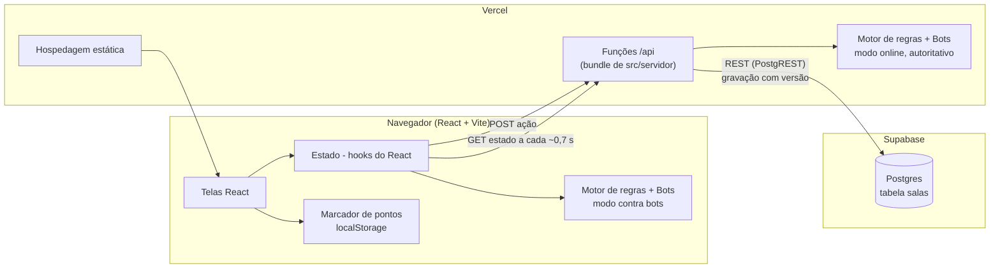
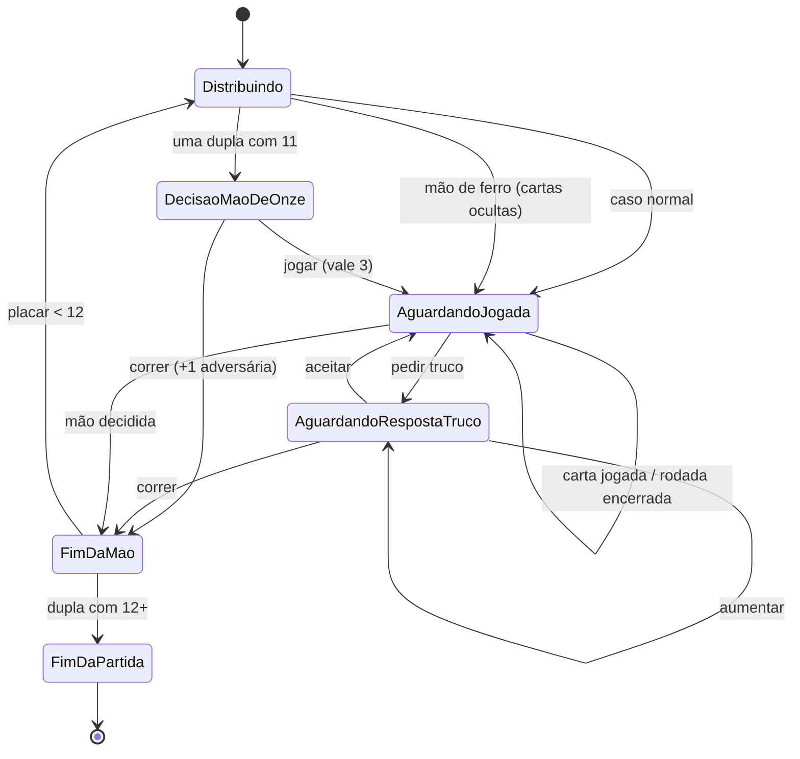
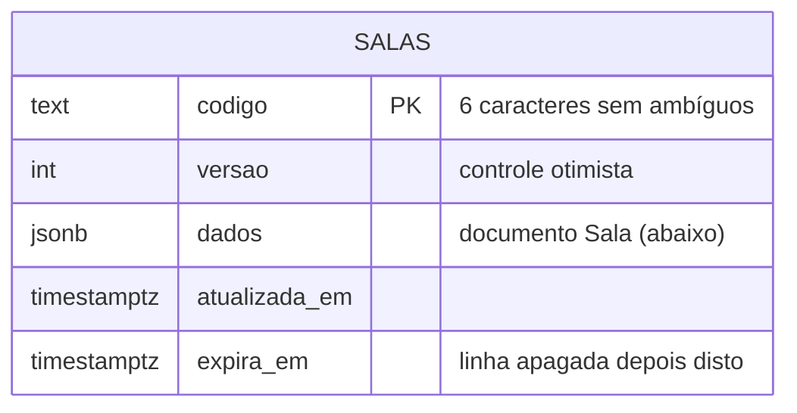

# Trucão da Barela — Plano de arquitetura e implementação

> Análise e Projeto de Software · Prof. Dr. João Choma · Situação: **Proposto**
> Documentos relacionados: [01 — Regras de negócio](regras-de-negocio.md) · [02 — Requisitos](requisitos.md) · [03 — Casos de uso](casos-de-uso.md)

## 1. Visão do produto

O **Trucão da Barela** é um jogo web de **truco paulista** para **duas duplas** (4 participantes), hospedado na Vercel, com:

- **Partida contra bots** — o jogador joga com um bot parceiro contra dois bots adversários, sem precisar de internet depois de carregado.
- **Partida online** — até 4 pessoas em uma sala identificada por código; vagas livres podem ser completadas com bots.
- **Marcador de pontos** — placar separado para quem joga com baralho físico.
- **Identidade visual própria** em estilo de blocos/pixel art (mesa, cartas, avatares e ambientação), com arte original.

### Decisões de escopo (propostas da análise)

| Decisão | Motivo |
|---|---|
| Sem cadastro/login: o jogador se identifica por apelido + avatar | Mantém o backend simples e reduz dados pessoais (RNF-007) |
| Partida contra bots roda 100% no navegador | Funciona offline e não consome backend |
| Partida online com **servidor autoritativo** em funções serverless | Impede trapaça e garante sigilo das cartas sem precisar de servidor dedicado |
| Marcador de pontos salvo só no dispositivo | Não precisa de rede nem de conta |
| Um único **motor de regras** em TypeScript, usado no navegador e no servidor | Uma única implementação das RNs, testável isoladamente |

Fora do escopo nesta versão: ranking global, chat de texto livre, apostas/pagamentos, contas de usuário, campeonatos.

## 2. Visão geral da arquitetura



**Fluxo online em uma frase:** o navegador envia a ação para `/api`; a função lê a sala no Postgres, valida com o motor, grava com controle de versão; e cada navegador, ao consultar o estado (a cada ~0,7 s), recebe **só a sua visão** e os eventos novos — e é nessa consulta que os bots jogam, no ritmo da mesa, e que prazos vencidos são aplicados.

**Decisão da fase 6 — consulta periódica em vez de Realtime.** Funções da Vercel não mantêm conexões abertas, e truco é por turnos. A consulta a cada ~0,7 s cumpre a meta de latência (RNF-003) sem SDK nem WebSocket, funciona igual com o banco em memória (`npm run dev`) e no Supabase, e deixa o servidor como único dono do relógio (bots e prazos). O ator secundário “Serviço de tempo real” dos casos de uso é atendido por essa consulta; o Supabase Realtime pode substituí-la depois sem mudar nenhum caso de uso.

## 3. Stack

| Camada | Escolha | Observação |
|---|---|---|
| Front-end | React 18 + Vite + TypeScript | SPA, deploy estático na Vercel |
| Rotas | React Router | `/`, `/bots`, `/sala/:codigo`, `/marcador`, `/regras`, `/perfil`, `/preferencias` |
| Estado | Hooks do React (`useState`, `useRef`) | Um hook por modo: `usePartidaContraBots`, `useSalaOnline`, `useMarcador` |
| Estilo | CSS com variáveis + arte em SVG gerada de mapas de pixels | Tema de blocos autoral; fontes pixel OFL (Google Fonts) |
| Animações | CSS (`steps()`), sem biblioteca | Combina com o estilo pixel e não pesa no pacote |
| Back-end | Vercel Functions com `Request`/`Response` padrão | `api/*.js` importam o bundle `api/_lib/servidor.mjs`, gerado de `src/servidor` por `npm run build:api` |
| Banco | Supabase Postgres via REST (PostgREST), sem SDK | Sem as variáveis, `npm run dev` usa banco em memória |
| Testes | Vitest (motor, bots, marcador, servidor) + Playwright (fluxos no navegador) | |
| Qualidade | ESLint + GitHub Actions | CI em todo PR |

## 4. Estrutura de pastas

```
trucao_da_barela/
├─ docs/                    # documentação da disciplina (este material)
├─ api/                     # funções da Vercel (finas): só chamam src/servidor/http.ts
│  ├─ _lib/servidor.mjs     # bundle gerado por `npm run build:api` (não editar)
│  ├─ salas/criar.js        # UC-005
│  ├─ salas/entrar.js       # UC-006, UC-015
│  ├─ salas/assentos.js     # UC-007
│  ├─ salas/estado.js       # visão do assento + bots + prazos (RN-018, RN-021)
│  ├─ salas/sair.js         # UC-014
│  ├─ partidas/iniciar.js   # UC-008, UC-016
│  └─ partidas/acao.js      # UC-010 a UC-013
├─ src/
│  ├─ engine/               # motor de regras PURO (sem React, sem rede)
│  ├─ bots/                 # RN-019, RF-021
│  ├─ marcador/             # RN-024, RN-025
│  ├─ servidor/             # salas, jogo autoritativo, repositório (memória/Supabase), rotas HTTP
│  ├─ online/               # cliente da API, credenciais, hook da sala e lobby
│  ├─ ui/                   # arte, mesa, sons, armazenamento, tema
│  └─ pages/                # telas
├─ supabase/migrations/     # SQL da tabela salas
└─ README.md
```

## 5. Motor de regras (núcleo)

O motor é uma função pura, no estilo *reducer*:

```ts
aplicarAcao(estado: EstadoPartida, acao: Acao): Resultado<EstadoPartida, ErroRegra>
visaoDoAssento(estado: EstadoPartida, assento: 0 | 1 | 2 | 3): VisaoMesa
acoesValidas(estado: EstadoPartida, assento): Acao[]   // usado por bots e pela UI
```

- Assentos `0..3` em **sentido anti-horário**; parceiros: `0–2` e `1–3` (RN-005).
- Embaralhamento com gerador pseudoaleatório **com semente**: em teste, a semente fixa reproduz qualquer mão; online, a semente fica só no servidor.
- Cada ação gera **eventos** (`CartaJogada`, `RodadaVencida`, `TrucoPedido`...). A UI usa os eventos para animar em sequência, inclusive jogadas de bots aplicadas de uma vez no servidor.

### Ações

`JOGAR_CARTA {indice, encoberta}` · `PEDIR_TRUCO` · `RESPONDER_TRUCO {aceitar | correr | aumentar}` · `DECIDIR_MAO_DE_ONZE {jogar | correr}` (sair é tratado pela sala, não pelo motor)

### Máquina de estados da mão



## 6. Bots (RN-019)

Os bots recebem **apenas a visão do seu assento** (mesma função `visaoDoAssento`), então não “enxergam” cartas alheias.

| Nível | Jogar carta | Truco | Mão de onze |
|---|---|---|---|
| Fácil | Carta válida aleatória | Pede raramente; aceita ao acaso | Joga se tiver manilha |
| Médio | Heurística: ganha a rodada com a menor carta suficiente; se o parceiro já ganha, descarta a menor | Pede/aceita conforme força da mão (pontuação por carta) | Soma força das 6 cartas da dupla |
| Difícil | Igual ao médio | Probabilidade de cada carta ser imbatível, calculada a partir das cartas já vistas na mão | Médio + mais disposição quando o adversário está perto de 12 |
| Todos | Guardam as cartas boas se o parceiro sinalizou zap/copas e ainda vai jogar | Somam a força sinalizada pelo parceiro (RN-027) | — |

Validação: um **simulador** (`src/bots/simulador.ts`) roda partidas bot × bot e acusa qualquer ação inválida. Resultado na fase 3 (1.000+ partidas por confronto, zero ações inválidas, decisão mais lenta abaixo de 7 ms):

| Confronto | Vitórias da 1ª dupla |
|---|---|
| Médio × fácil | ≈ 90% |
| Difícil × fácil | ≈ 86% |
| Difícil × médio | ≈ 61% |

Blefe, “pagar para ver”, abrir com a carta mais fraca e encobrir no descarte foram testados para o difícil e **pioraram** o desempenho (vencia o médio em só 53%), por isso ficaram de fora.

## 7. Modelo de dados (online)

Na implementação (fase 6), cada sala é **uma linha** com o documento completo em `jsonb`. Assim, sala, participantes e partida são lidos e gravados juntos, numa única escrita condicional — sem transações entre tabelas.



Documento `Sala` (`src/servidor/tipos.ts`), com as mesmas entidades do modelo conceitual:

| Campo | Conteúdo |
|---|---|
| `situacao`, `anfitriao`, `criadaEm`, `expiraEm` | Sala (RN-020) |
| `assentos[0..3]` | Participante: humano ou bot, apelido, avatar, nível, **hash** da credencial, último sinal de presença, saiu (RN-022, RN-023) |
| `partida` | Estado completo do motor — mão, rodadas, cartas, placar (nunca enviado ao navegador) |
| `lotes` | Últimos 40 lotes de eventos, entregues filtrados por assento |
| `destaque`, `prazo`, `proximoBotEm` | Pausa de fim de rodada, prazo do humano (RN-021) e ritmo dos bots |

- O navegador recebe só `RespostaEstado`: visão do assento, assentos públicos e eventos filtrados (RNF-002).
- Gravação com `PATCH ...?codigo=eq.X&versao=eq.N`: se outra requisição gravou antes, o servidor relê e reaplica (RNF-001).
- A tabela só é acessada pelas funções, com a chave de serviço; RLS ligado e sem políticas para a chave pública.
- A linha é apagada 24 h após a expiração ou o encerramento da sala (RNF-007).

Modo contra bots e marcador usam `localStorage` com chaves versionadas: `trucao.perfil.v1`, `trucao.preferencias.v1`, `trucao.partidaBots.v1`, `trucao.marcador.v1`, `trucao.salas.v1` (credenciais de assento).

## 8. API

A credencial do assento vai no cabeçalho `x-credencial` (exceto na criação).

| Método e rota | Uso | UC |
|---|---|---|
| `POST /api/salas/criar` | cria sala; devolve código e credencial do anfitrião | UC-005 |
| `POST /api/salas/entrar` | ocupa assento; com credencial guardada, reconecta | UC-006, UC-015 |
| `POST /api/salas/assentos` | mover, adicionar/remover bot, trocar, sortear | UC-007 |
| `GET /api/salas/estado?codigo&desde` | visão do assento e eventos novos; registra presença, faz os bots jogarem e aplica prazos vencidos | RF-021, RF-022, RN-021, RN-022 |
| `POST /api/salas/sair` | sair da sala ou da partida | UC-014 |
| `POST /api/partidas/iniciar` | inicia a partida ou a revanche | UC-008, UC-016 |
| `POST /api/partidas/acao` | jogar carta, pedir/responder truco, mão de onze | UC-010 a UC-013 |

Erros vêm como `{ erro, codigo }` com status HTTP adequado (404 sala inexistente, 409 sala cheia/em jogo, 401 credencial inválida, 403 sem permissão, 422 regra do jogo).

## 9. Telas

1. **Início** — perfil (apelido + avatar), botões: Jogar contra bots · Jogar online · Marcador · Regras.
2. **Configurar partida contra bots** — dificuldade do parceiro e dos adversários.
3. **Sala online (lobby)** — código para compartilhar, 4 assentos em cruz mostrando as duplas, botões de bot.
4. **Mesa** — vista de cima; jogador embaixo, parceiro em frente; vira e manilha destacadas; placar; valor da mão; indicador de vez e tempo; botões Truco / Aceitar / Correr / Aumentar; registro de eventos.
5. **Fim de partida** — vencedora, placar, revanche.
6. **Marcador** — dois blocos grandes (Nós × Eles), botões +1/+3/+6/+9/+12, desfazer, histórico.
7. **Regras/Tutorial** — regras ilustradas e uma mão guiada.

Direção de arte (detalhada na fase 4): mesa de madeira em pixel art, verso das cartas com textura de terra/grama em blocos, naipes redesenhados como itens em pixel art e avatares de personagens originais em estilo de blocos (ex.: mineradora, lenhador, ferreira, explorador). Personagens, logotipos e artes de jogos de terceiros não são reproduzidos (RNF-010).

## 9.1 Efeitos sonoros (espaço para áudios próprios)

Cada evento importante da mesa tem um **slot de som**. Se houver um arquivo de áudio no slot, ele é tocado; se não houver, o jogo usa um som sintetizado de reserva (Web Audio), então nada quebra com slots vazios.

```
public/sons/
├─ manifesto.json        # evento -> arquivo (edite só aqui)
├─ truco.mp3             # arquivos fornecidos pela equipe
└─ ...
```

```json
{
  "distribuir": "distribuir.mp3",
  "jogar": "jogar.mp3",
  "encoberta": null,
  "suaVez": null,
  "tempoAcabando": null,
  "manilha": null,
  "zap": null,
  "truco": "truco.mp3",
  "seis": null,
  "nove": null,
  "doze": null,
  "aceitar": null,
  "correr": null,
  "ganharRodada": null,
  "ganharMao": null,
  "maoDeOnze": null,
  "maoDeFerro": null,
  "vitoria": null,
  "derrota": null,
  "entrouSala": null,
  "saiuSala": null
}
```

- `src/ui/sons.ts` carrega o manifesto, pré-carrega os arquivos e expõe `tocar(evento)`; `null` ou arquivo ausente → som sintetizado.
- O motor emite eventos (`TrucoPedido{valor: 12}`, `PartidaVencida`...) e um mapeador converte cada evento em um slot, sem o motor conhecer áudio.
- Volume e liga/desliga vêm das preferências (UC-002). Formatos aceitos: `.mp3`, `.ogg` ou `.wav`; recomendado até 3 s e 200 KB por arquivo.
- Origem e licença de cada arquivo colocado nos slots ficam registradas na seção de créditos do README (RNF-010).

## 9.2 Sinais ao parceiro (RN-027)

- O motor tem a ação `SINALIZAR {sinal}` (`src/engine/sinais.ts`): até 3 sinais distintos por participante e por mão, fora da vez inclusive, proibidos na mão de ferro. O sinal não muda vez nem valor.
- Sigilo: `visaoDoAssento` só mostra os sinais da própria dupla, e `eventosParaAssento` descarta o evento `SINAL_ENVIADO` para a outra dupla — no servidor e também na partida contra bots.
- Bots (`src/bots/sinais.ts`) sinalizam, logo depois da distribuição, as duas melhores cartas que têm sinal (ou "nada"). O fácil esquece metade das vezes. Ao decidir, leem os sinais do parceiro: somam força ao avaliar truco e, se o parceiro avisou zap ou copas e ainda vai jogar, guardam as cartas boas.
- Online, o sinal humano não mexe no prazo, na pausa nem no ritmo dos bots.
- Medido no simulador (2.000 partidas por confronto): a dupla de médios que troca sinais vence ≈ 60% contra a que não troca; nos difíceis, ≈ 57%. O peso do sinal no difícil (0,4) foi calibrado para ele continuar vencendo o médio (≈ 64%).

## 10. Plano de implementação por fases

| Fase | Entrega | Pronto quando |
|---|---|---|
| **0. Documentação** *(agora)* | RN, RF/RNF, UC com CA/CT; depois diagrama de casos de uso e diagramas de sequência | Checklist de validação dos UCs sem pendências |
| **1. Base do projeto** | Vite + React + TS, ESLint, Vitest, CI, deploy na Vercel | Página inicial no ar pela Vercel |
| **2. Motor de regras** | `src/engine` completo | Um teste para cada RN-001 a RN-018 e RN-026 passando |
| **3. Bots** | 3 níveis + simulador | 10.000 partidas simuladas sem ação inválida |
| **4. Mesa offline + arte** | UC-001 a UC-004, UC-009 a UC-014, UC-016 | Partida completa contra bots no celular e no desktop |
| **5. Marcador** | UC-017 a UC-020 | CTs do marcador aprovados |
| **6. Online** | Servidor autoritativo + `/api` + lobby; UC-005 a UC-008, UC-014 a UC-016 | Navegadores diferentes jogando uma partida até o fim, com saída, reconexão e revanche |
| **7. Polimento** | Sons, tutorial guiado, acessibilidade, e2e | RNF-003 a RNF-005 verificados |

Cada fase vira uma branch e um PR; cada PR cita os IDs (RN/RF/UC/CT) que implementa, mantendo a rastreabilidade do documento até o código.

## 11. Riscos e mitigação

| Risco | Mitigação |
|---|---|
| Variações regionais do truco paulista geram divergência | Variações documentadas como regras parametrizáveis (RN-007, RN-014, RN-021) e explicadas na tela de regras |
| Limite do plano gratuito do Supabase | Apenas avisos pequenos no canal; limpeza de salas em 24 h |
| Partida online travar por jogador ausente | Prazo de decisão + bot assume a vaga (RN-021, RN-022) |
| Bots fracos ou previsíveis | Simulador e ajuste de pesos na fase 3 |
| Uso de arte de terceiros | Arte própria; registro de licença de fontes e sons no README (RNF-010) |
