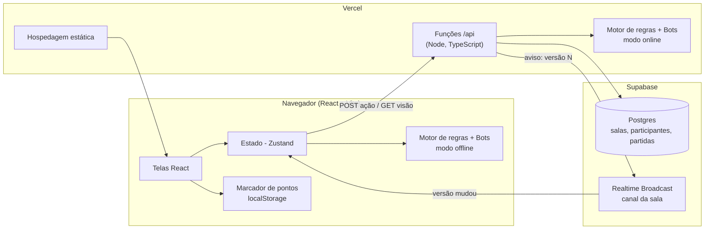
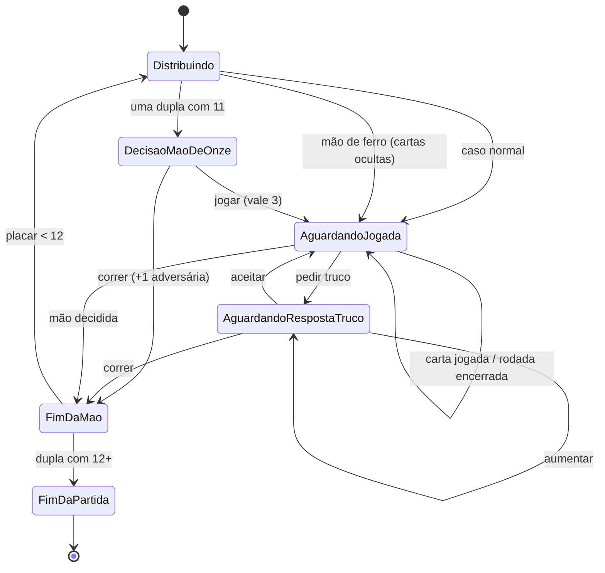
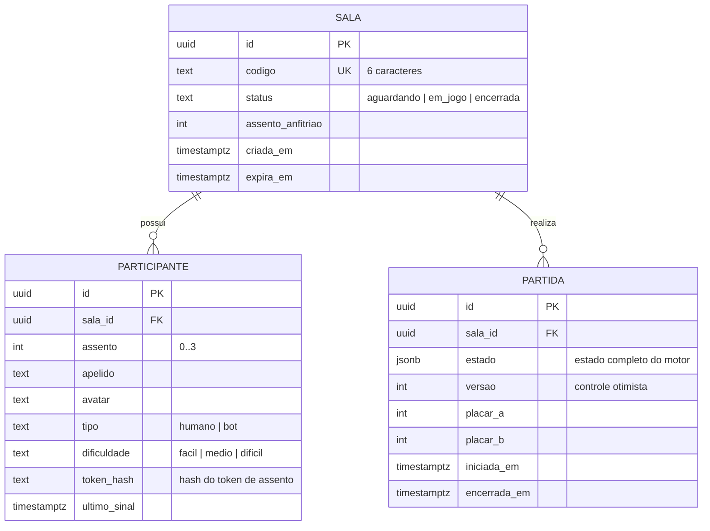

# Trucão da Barela — Plano de arquitetura e implementação

> Análise e Projeto de Software · Prof. Dr. João Choma · Situação: **Proposto**
> Documentos relacionados: [Regras de negócio](regras-de-negocio.md) · [Requisitos](requisitos.md) · [Casos de uso](casos-de-uso.md)

## 1. Visão do produto

O **Trucão da Barela** é um jogo web de **truco paulista** para **duas duplas** (4 participantes), hospedado na Vercel, com:

- **Partida contra bots** — o jogador joga com um bot parceiro contra dois bots adversários, sem precisar de internet depois de carregado.
- **Partida online** — até 4 pessoas em uma sala identificada por código; vagas livres podem ser completadas com bots.
- **Marcador de pontos** — placar separado para quem joga com baralho físico.
- **Identidade visual própria** em estilo de blocos/pixel art (mesa, cartas, avatares e ambientação), com arte original.

### Decisões de escopo (propostas da análise)

| Decisão | Motivo |
|---|---|
| Sem cadastro/login: o jogador se identifica por apelido + avatar | Mantém o backend simples e reduz dados pessoais (RNF-007) |
| Partida contra bots roda 100% no navegador | Funciona offline e não consome backend |
| Partida online com **servidor autoritativo** em funções serverless | Impede trapaça e garante sigilo das cartas sem precisar de servidor dedicado |
| Marcador de pontos salvo só no dispositivo | Não precisa de rede nem de conta |
| Um único **motor de regras** em TypeScript, usado no navegador e no servidor | Uma única implementação das RNs, testável isoladamente |

Fora do escopo nesta versão: ranking global, chat de texto livre, apostas/pagamentos, contas de usuário, campeonatos.

## 2. Visão geral da arquitetura



**Fluxo online em uma frase:** o cliente envia a ação para `/api`, a função carrega o estado da partida no Postgres, valida com o motor, aplica jogadas de bots pendentes, grava com controle de versão e publica no canal da sala apenas “versão N disponível”; cada cliente então busca **a sua visão** (só suas cartas) com seu token de assento.

Por que não WebSocket próprio: funções da Vercel não mantêm conexões abertas. Truco é por turnos, então requisição + aviso em tempo real é suficiente (latência alvo < 1 s, RNF-003).

## 3. Stack

| Camada | Escolha | Observação |
|---|---|---|
| Front-end | React 18 + Vite + TypeScript | SPA, deploy estático na Vercel |
| Rotas | React Router | `/`, `/bots`, `/sala/:codigo`, `/marcador`, `/regras` |
| Estado | Zustand | Simples, sem boilerplate |
| Estilo | CSS Modules + variáveis CSS | Tema pixel; fonte pixel com licença OFL (Google Fonts) |
| Animações | Framer Motion | Distribuição, jogada e recolhimento de cartas |
| Back-end | Vercel Functions (`/api/*.ts`) | Sem servidor dedicado |
| Banco + tempo real | Supabase (Postgres + Realtime Broadcast) | Plano gratuito |
| Testes | Vitest (motor/bots), Testing Library (UI), Playwright (e2e) | |
| Qualidade | ESLint + Prettier + GitHub Actions | CI em todo PR |

## 4. Estrutura de pastas proposta

```
trucao_da_barela/
├─ docs/                    # documentação da disciplina (este material)
├─ api/                     # funções serverless da Vercel
│  ├─ salas/criar.ts        # UC-005
│  ├─ salas/entrar.ts       # UC-006, UC-015
│  ├─ salas/assentos.ts     # UC-007
│  ├─ partidas/iniciar.ts   # UC-008, UC-016
│  ├─ partidas/acao.ts      # UC-010 a UC-014
│  ├─ partidas/visao.ts     # visão por assento (RN-018)
│  └─ partidas/prazo.ts     # decisões expiradas (RN-021)
├─ src/
│  ├─ engine/               # motor de regras PURO (sem React, sem rede)
│  │  ├─ baralho.ts         # RN-001..RN-004
│  │  ├─ mesa.ts            # RN-005..RN-008
│  │  ├─ rodada.ts          # RN-009..RN-011
│  │  ├─ truco.ts           # RN-012..RN-014
│  │  ├─ maoDeOnze.ts       # RN-015, RN-016
│  │  ├─ partida.ts         # RN-017, RN-026 + aplicarAcao()
│  │  ├─ visao.ts           # RN-018: estado -> visão do assento
│  │  └─ __tests__/         # um arquivo de teste por RN
│  ├─ bots/                 # RN-019: facil.ts, medio.ts, dificil.ts
│  ├─ marcador/             # RN-024, RN-025
│  ├─ online/               # cliente da API + assinatura do canal
│  ├─ ui/                   # componentes (Mesa, Carta, Avatar, Placar...)
│  ├─ pages/                # telas
│  └─ assets/               # arte original (cartas, avatares, sons)
├─ supabase/migrations/     # SQL das tabelas
└─ README.md
```

## 5. Motor de regras (núcleo)

O motor é uma função pura, no estilo *reducer*:

```ts
aplicarAcao(estado: EstadoPartida, acao: Acao): Resultado<EstadoPartida, ErroRegra>
visaoDoAssento(estado: EstadoPartida, assento: 0 | 1 | 2 | 3): VisaoMesa
acoesValidas(estado: EstadoPartida, assento): Acao[]   // usado por bots e pela UI
```

- Assentos `0..3` em **sentido anti-horário**; parceiros: `0–2` e `1–3` (RN-005).
- Embaralhamento com gerador pseudoaleatório **com semente**: em teste, a semente fixa reproduz qualquer mão; online, a semente fica só no servidor.
- Cada ação gera **eventos** (`CartaJogada`, `RodadaVencida`, `TrucoPedido`...). A UI usa os eventos para animar em sequência, inclusive jogadas de bots aplicadas de uma vez no servidor.

### Ações

`JOGAR_CARTA {carta, encoberta}` · `PEDIR_TRUCO` · `RESPONDER_TRUCO {aceitar | correr | aumentar}` · `DECIDIR_MAO_DE_ONZE {jogar | correr}` · `SAIR`

### Máquina de estados da mão



## 6. Bots (RN-019)

Os bots recebem **apenas a visão do seu assento** (mesma função `visaoDoAssento`), então não “enxergam” cartas alheias.

| Nível | Jogar carta | Truco | Mão de onze |
|---|---|---|---|
| Fácil | Carta válida aleatória | Pede raramente; aceita ao acaso | Joga se tiver manilha |
| Médio | Heurística: ganha a rodada com a menor carta suficiente; se o parceiro já ganha, descarta a menor | Pede/aceita conforme força da mão (pontuação por carta) | Soma força das 6 cartas da dupla |
| Difícil | Médio + memória de cartas já jogadas e de manilhas restantes | Médio + blefe ocasional e leitura do placar | Médio + risco conforme placar |

Validação: um **simulador** roda milhares de partidas bot × bot (ex.: Difícil deve vencer Fácil com folga) e acusa qualquer ação inválida.

## 7. Modelo de dados (online)



- O cliente nunca recebe `PARTIDA.estado`; recebe só a visão do assento (RNF-002).
- Gravação com `UPDATE ... WHERE versao = N`: se duas ações chegam juntas, a segunda é recusada e reavaliada (RNF-001).
- Tabelas acessadas apenas pelas funções `/api` (chave de serviço); RLS bloqueando acesso direto do navegador.
- Dados de salas encerradas apagados após 24 h (RNF-007).

Modo offline e marcador usam `localStorage` com chaves versionadas: `trucao.perfil.v1`, `trucao.preferencias.v1`, `trucao.marcador.v1`.

## 8. API (resumo)

| Método e rota | Uso | UC |
|---|---|---|
| `POST /api/salas/criar` | cria sala; devolve código e token do anfitrião | UC-005 |
| `POST /api/salas/entrar` | ocupa assento ou reconecta com token | UC-006, UC-015 |
| `POST /api/salas/assentos` | trocar assento, adicionar/remover bot | UC-007 |
| `POST /api/partidas/iniciar` | inicia partida ou revanche | UC-008, UC-016 |
| `POST /api/partidas/acao` | jogar, truco, resposta, mão de onze, sair | UC-010 a UC-014 |
| `GET /api/partidas/visao` | visão do assento autenticado pelo token | todos da mesa |
| `POST /api/partidas/prazo` | qualquer cliente avisa prazo vencido; o servidor confere o relógio | RN-021 |

## 9. Telas

1. **Início** — perfil (apelido + avatar), botões: Jogar contra bots · Jogar online · Marcador · Regras.
2. **Configurar partida contra bots** — dificuldade do parceiro e dos adversários.
3. **Sala online (lobby)** — código para compartilhar, 4 assentos em cruz mostrando as duplas, botões de bot.
4. **Mesa** — vista de cima; jogador embaixo, parceiro em frente; vira e manilha destacadas; placar; valor da mão; indicador de vez e tempo; botões Truco / Aceitar / Correr / Aumentar; registro de eventos.
5. **Fim de partida** — vencedora, placar, revanche.
6. **Marcador** — dois blocos grandes (Nós × Eles), botões +1/+3/+6/+9/+12, desfazer, histórico.
7. **Regras/Tutorial** — regras ilustradas e uma mão guiada.

Direção de arte (detalhada na fase 4): mesa de madeira em pixel art, verso das cartas com textura de terra/grama em blocos, naipes redesenhados como itens em pixel art e avatares de personagens originais em estilo de blocos (ex.: mineradora, lenhador, ferreira, explorador). Personagens, logotipos e artes de jogos de terceiros não são reproduzidos (RNF-010).

## 9.1 Efeitos sonoros (espaço para áudios próprios)

Cada evento importante da mesa tem um **slot de som**. Se houver um arquivo de áudio no slot, ele é tocado; se não houver, o jogo usa um som sintetizado de reserva (Web Audio), então nada quebra com slots vazios.

```
public/sons/
├─ manifesto.json        # evento -> arquivo (edite só aqui)
├─ truco.mp3             # arquivos fornecidos pela equipe
└─ ...
```

```json
{
  "distribuir": "distribuir.mp3",
  "jogar": "jogar.mp3",
  "encoberta": null,
  "suaVez": null,
  "tempoAcabando": null,
  "manilha": null,
  "zap": null,
  "truco": "truco.mp3",
  "seis": null,
  "nove": null,
  "doze": null,
  "aceitar": null,
  "correr": null,
  "ganharRodada": null,
  "ganharMao": null,
  "maoDeOnze": null,
  "maoDeFerro": null,
  "vitoria": null,
  "derrota": null,
  "entrouSala": null,
  "saiuSala": null
}
```

- `src/ui/sons.ts` carrega o manifesto, pré-carrega os arquivos e expõe `tocar(evento)`; `null` ou arquivo ausente → som sintetizado.
- O motor emite eventos (`TrucoPedido{valor: 12}`, `PartidaVencida`...) e um mapeador converte cada evento em um slot, sem o motor conhecer áudio.
- Volume e liga/desliga vêm das preferências (UC-002). Formatos aceitos: `.mp3`, `.ogg` ou `.wav`; recomendado até 3 s e 200 KB por arquivo.
- Origem e licença de cada arquivo colocado nos slots ficam registradas na seção de créditos do README (RNF-010).

## 10. Plano de implementação por fases

| Fase | Entrega | Pronto quando |
|---|---|---|
| **0. Documentação** *(agora)* | RN, RF/RNF, UC com CA/CT; depois diagrama de casos de uso e diagramas de sequência | Checklist de validação dos UCs sem pendências |
| **1. Base do projeto** | Vite + React + TS, ESLint, Vitest, CI, deploy na Vercel | Página inicial no ar pela Vercel |
| **2. Motor de regras** | `src/engine` completo | Um teste para cada RN-001 a RN-018 e RN-026 passando |
| **3. Bots** | 3 níveis + simulador | 10.000 partidas simuladas sem ação inválida |
| **4. Mesa offline + arte** | UC-001 a UC-004, UC-009 a UC-014, UC-016 | Partida completa contra bots no celular e no desktop |
| **5. Marcador** | UC-017 a UC-020 | CTs do marcador aprovados |
| **6. Online** | Supabase + `/api` + lobby; UC-005 a UC-008, UC-015 | 4 navegadores jogando uma partida até o fim |
| **7. Polimento** | Sons, tutorial guiado, acessibilidade, e2e | RNF-003 a RNF-005 verificados |

Cada fase vira uma branch e um PR; cada PR cita os IDs (RN/RF/UC/CT) que implementa, mantendo a rastreabilidade do documento até o código.

## 11. Riscos e mitigação

| Risco | Mitigação |
|---|---|
| Variações regionais do truco paulista geram divergência | Variações documentadas como regras parametrizáveis (RN-007, RN-014, RN-021) e explicadas na tela de regras |
| Limite do plano gratuito do Supabase | Apenas avisos pequenos no canal; limpeza de salas em 24 h |
| Partida online travar por jogador ausente | Prazo de decisão + bot assume a vaga (RN-021, RN-022) |
| Bots fracos ou previsíveis | Simulador e ajuste de pesos na fase 3 |
| Uso de arte de terceiros | Arte própria; registro de licença de fontes e sons no README (RNF-010) |
